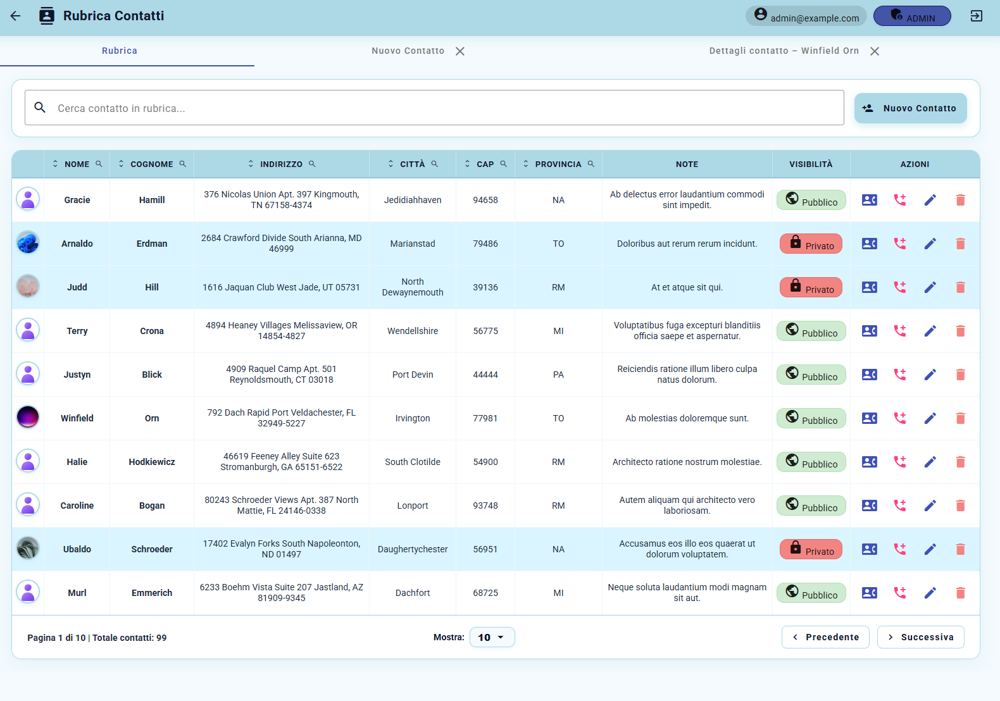
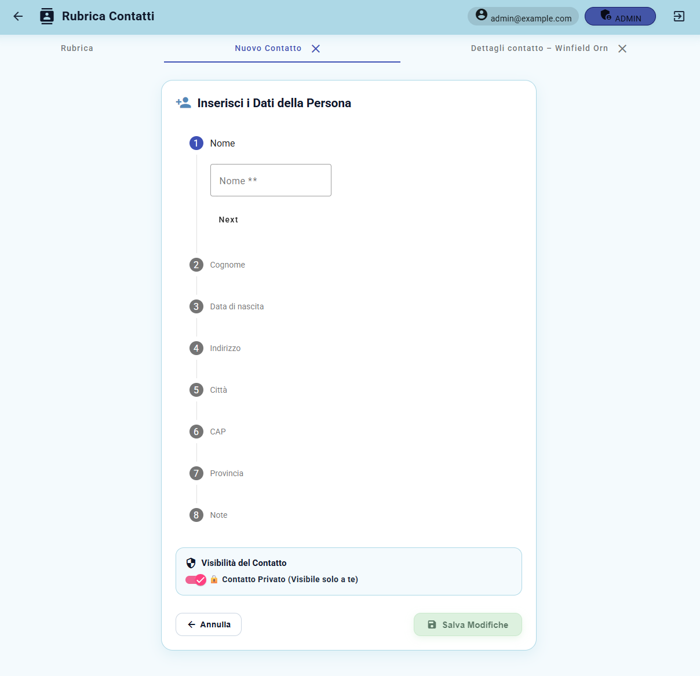
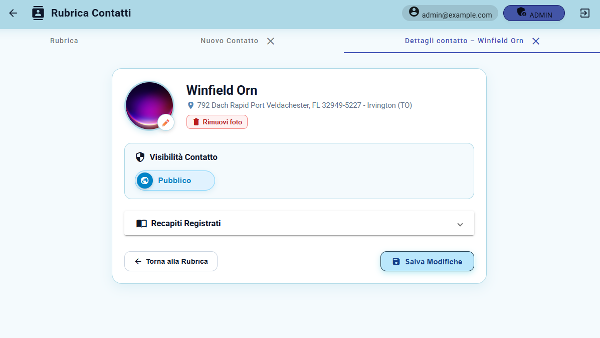

# Aurora Amoroso — Developer Portfolio 👩🏻‍💻

Personal portfolio developed with **Angular** and **TypeScript** to present my professional profile, technical skills, work experience and Full Stack projects.

🌐 **Live Portfolio:**  
https://aurora-portfolio-phi.vercel.app

---

## 👋 About Me

I'm **Aurora Amoroso**, a Computer Engineering graduate currently pursuing a Master's Degree in Artificial Intelligence at the University of Palermo.

I currently work at **Fiber Telecom S.p.A.**, where I followed a cross-functional path through:

**NOC → Provisioning → IT / Full Stack Development**

This experience allowed me to develop a broader understanding of software development, networking, telecommunications infrastructure and operational business processes.

Today I mainly focus on **Full Stack Web Development**, working with Angular, TypeScript, Laravel, PHP, REST APIs and relational databases.

---

## 💻 Tech Stack

### Frontend

- Angular
- TypeScript
- HTML5
- CSS3
- Responsive Design

### Backend

- Laravel
- PHP
- REST APIs
- JWT Authentication

### Database

- MySQL
- PostgreSQL
- SQL

### Development Tools

- Git
- GitHub
- Visual Studio Code
- API integration
- Debugging

### Networking Background

- TCP/IP
- DHCP
- OSPF
- PPPoE
- RADIUS
- MikroTik
- Winbox
- Zabbix
- Dude
- NetBox

---

# 🚀 Featured Project

## Rubrica Contatti

A Full Stack web application designed to manage people and their contact information.

The application combines an **Angular + TypeScript frontend** with a **Laravel + PHP backend** and a **MySQL database**.

### Main Features

- User authentication
- JWT authentication
- Contact management
- Complete CRUD operations
- Search
- Sorting
- Pagination
- Public and private contacts
- Image upload
- REST API communication
- User authorization
- MySQL data persistence

### Technologies

`Angular` `TypeScript` `Laravel` `PHP` `MySQL` `JWT` `REST API`

### Repository

https://github.com/Aurora0405/Rubrica-finale

---

## 📸 Project Preview

### Contact Dashboard

### Create Contact

### Contact Details

---

# 💼 Professional Experience

## Fiber Telecom S.p.A.

### IT / Full Stack Developer

Current position focused on Full Stack web development.

Main activities include:

- Angular and TypeScript frontend development
- Laravel and PHP backend development
- REST API development and integration
- MySQL database management
- Authentication and user management
- Debugging
- Development of new application features
- Git and GitHub version control

### Provisioning

Previous cross-functional experience involving:

- FTTX services
- Dedicated connectivity services
- Carrier portals
- Order monitoring
- Escalations
- NetBox
- Data Center resources
- Coordination between technical departments

### Network Operations Center

Initial professional experience involving:

- Network monitoring with Zabbix and Dude
- First-level troubleshooting
- Ticket management
- Escalation management
- MikroTik and Winbox
- DHCP
- OSPF
- PPPoE
- RADIUS
- Network device fundamentals

---

# 🧠 Education

### Master's Degree in Artificial Intelligence

**University of Palermo**

Currently attending.

### Bachelor's Degree in Computer Engineering

**University of Palermo**

---

# 🌐 Portfolio

The portfolio itself was developed using:

- Angular
- TypeScript
- HTML
- CSS

and deployed through **Vercel** with automatic deployment from GitHub.

🔗 **Live version:**  
https://aurora-portfolio-phi.vercel.app

---

# 📬 Contact

**Aurora Amoroso**

GitHub  
https://github.com/Aurora0405

LinkedIn  
https://www.linkedin.com/in/aurora-amoroso/

Email  
aurora.amoroso4@gmail.com

---

  Designed & developed by Aurora Amoroso

